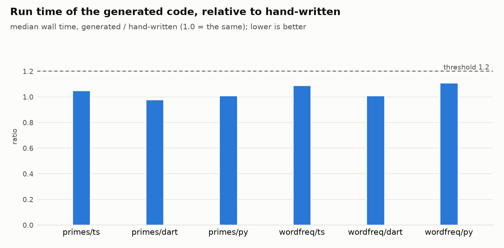
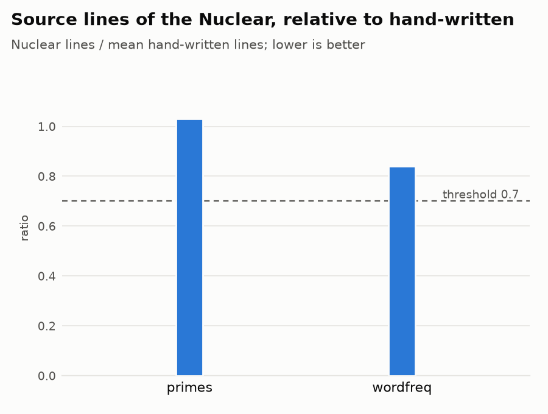

# The thesis, measured

Generated by `tools/thesis/report.py` from `results/bench.json` and `results/agents.json`. What each thesis claims, how it is measured and the thresholds are in `tools/thesis/README.md`. Every chart has its table above it (the table is the accessible view; the charts are light mode).

## A. Agents: the same app with less work

No runs yet: `tools/thesis/run.py --arm both --repeats 3` (it uses the user's Claude account; see the README for the cost).

## B. Generated code: as fast as an expert's

Bench of 2026-11-06, median of 5 runs each; the generated program and the hand-written one must print the same text.

| Program | Language | Generated (ms) | Hand-written (ms) | Ratio | Same output |
|---|---|---|---|---|---|
| primes | ts | 111.4 | 106.3 | 1.05 | yes |
| primes | dart | 135.0 | 137.5 | 0.98 | yes |
| primes | py | 2122.0 | 2099.0 | 1.01 | yes |
| wordfreq | ts | 109.0 | 100.4 | 1.09 | yes |
| wordfreq | dart | 65.1 | 64.2 | 1.01 | yes |
| wordfreq | py | 325.3 | 292.3 | 1.11 | yes |

### Verdict B

- worst ratio generated / hand-written = **1.11** (threshold ≤ 1.2); identical output: **yes**
- **Thesis B HOLDS** on 2 programs × 3 languages

## C. Nuclear is shorter than the code it replaces

| Program | Nuclear lines | TypeScript (hand) | Dart (hand) | Python (hand) | Nuclear / mean hand |
|---|---|---|---|---|---|
| primes | 21 | 21 | 20 | 20 | 1.03 |
| wordfreq | 16 | 21 | 19 | 17 | 0.84 |

### Verdict C

- worst ratio Nuclear / hand-written lines = **1.03** (threshold ≤ 0.7)
- **Thesis C DOES NOT HOLD** on 2 programs
